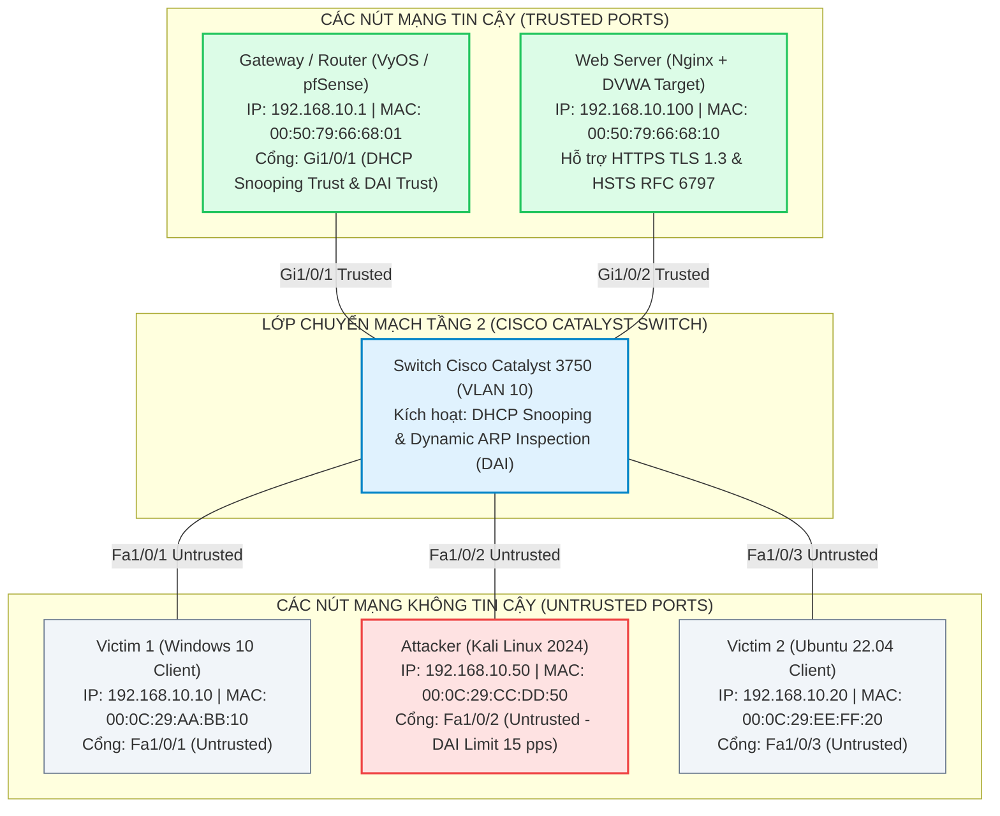

# BÁO CÁO NGHIÊN CỨU NIÊN LUẬN / KHÓA LUẬN CHUYÊN NGÀNH

## Nghiên Cứu Kỹ Thuật Khai Thác Và Phòng Chống Tấn Công Man-in-the-Middle

  Mã đề tài: 2026.MITM.01
  Trường: ĐH Đồng Tháp (DTHU)
  Khoa Công nghệ & Kỹ thuật
  Chuyên ngành: Mạng máy tính & An ninh
  Niên khóa: 2023 – 2027

---

## 🎯 Mục Đích Hệ Thống Tài Liệu Trực Tuyến

Hệ thống tài liệu Web Docsify này là cổng thông tin tổng hợp (Dashboard) phục vụ Giảng viên hướng dẫn và Hội đồng đánh giá theo dõi toàn diện tiến độ nghiên cứu, hồ sơ học vụ, toàn văn bản thảo báo cáo, dữ liệu đo kiểm thực nghiệm và tải trực tiếp các ấn phẩm PDF chính thức của đề tài.

---

## 📋 Thông Tin Học Vụ Chính Thức

| Thông tin | Chi tiết chính thức |
|:---|:---|
| **Cơ sở đào tạo** | Trường Đại học Đồng Tháp (DTHU) |
| **Khoa / Viện** | Khoa Công nghệ và Kỹ thuật |
| **Ngành đào tạo** | Khoa học máy tính |
| **Chuyên ngành** | Mạng Máy Tính và An Ninh |
| **Khóa học / Niên khóa** | Khóa 2023 – 2027 |
| **Sinh viên thực hiện** | **Nguyễn Thị Kỳ Duyên** |
| **Mã số sinh viên (MSSV)** | `0023410647` |
| **Lớp sinh hoạt** | ĐHCNTT23B-CS |
| **Giảng viên hướng dẫn** | **ThS. Trịnh Lê Hoàng Tuấn** |

---

## 🧭 Định Hướng Trọng Tâm Cốt Lõi (Scope Boundary - Chống Lệch Đề)

> [!IMPORTANT]
> **Cam kết liêm chính học thuật và tập trung phạm vi:** Đề tài tập trung 100% công sức giải quyết bài toán phân tích bản chất kỹ thuật khai thác và thiết lập giải pháp phòng chống đa lớp trước các cuộc tấn công Man-in-the-Middle (MitM) trong môi trường mạng phòng thử nghiệm an toàn (Isolated Lab). Tuyệt đối không phát triển dàn trải ngoài phạm vi nghiên cứu đã được phê duyệt.

* **Trọng tâm 1 (Kỹ thuật then chốt - 100% công sức):**
  * Hệ thống hóa toàn diện các kỹ thuật dẫn đường: **ARP Spoofing/Poisoning**, **DNS Spoofing**, **DHCP Spoofing (Rogue DHCP Server)**, **ICMP Redirect**, **Rogue AP**, và **SSL Stripping**.
  * Phân tích các kiểu tấn công khai thác phiên và dữ liệu: **Session Hijacking**, **Đánh cắp Cookie xác thực**, và **Giả mạo nội dung (Content Tampering / Malicious JavaScript Injection)**.
  * Hiện thực hóa mô hình phòng thử nghiệm Testbed Lab gồm 5 thành phần: 01 máy Kali Linux (Attacker), 02 máy nạn nhân (Victim 1 - Windows, Victim 2 - Linux), 01 Gateway/Router và 01 Web Server Nginx.
  * Triển khai đồng bộ các giải pháp phòng thủ hiện đại:
    * **HTTPS / HSTS (RFC 6797):** Bắt buộc kết nối bảo mật, vô hiệu hóa SSL Stripping.
    * **Dynamic ARP Inspection (DAI):** Kiểm tra tính hợp lệ của gói tin ARP tại Switch tầng 2, triệt tiêu ARP Spoofing.
    * **DHCP Snooping:** Phân loại cổng Trusted/Untrusted, loại bỏ máy chủ DHCP lậu và xây dựng cơ sở dữ liệu liên kết (Binding Database).
    * **Mạng riêng ảo (VPN):** Mã hóa toàn bộ lưu lượng tầng mạng bằng WireGuard/IPsec.
    * **Phát hiện ARP bất thường:** Kịch bản Python tự động phát hiện xung đột MAC-IP theo thời gian thực.

* **Trọng tâm 2 (Thực nghiệm & Kiểm chứng định lượng):**
  * Đo kiểm thực tế 5 kịch bản tấn công trước khi áp dụng giải pháp phòng vệ (thu thập log, bắt mật khẩu và Cookie).
  * Kích hoạt toàn bộ hệ thống phòng thủ, chạy lại các kịch bản tấn công để chứng minh các cuộc tấn công đã bị vô hiệu hóa hoàn toàn (100% gói tin ARP giả bị Drop, 0% tài khoản bị rò rỉ, 0% khả năng hạ cấp SSL).
  * Xây dựng bảng đối sánh định lượng các chỉ số an toàn và hiệu năng mạng.

---

## 🗺️ Sơ Đồ Cấu Trúc Phòng Thử Nghiệm Thực Nghiệm (Testbed Lab)

---

## 📊 Bảng Tóm Tắt Kết Quả Kiểm Chứng Thực Nghiệm

| Vectơ tấn công | Công cụ kiểm thử | Kết quả khi Chưa phòng vệ | Kết quả Sau khi Kích hoạt phòng vệ | Đánh giá an ninh |
|:---|:---|:---:|:---:|:---:|
| **ARP Cache Poisoning** | Scapy / Arpspoof | 100% bảng ARP bị nhiễm độc | **0%** (Switch DAI drop gói tin giả) | **Triệt tiêu tận gốc** |
| **Đánh cắp mật khẩu HTTP** | Wireshark / Tcpdump | Bắt được 10/10 mật khẩu bản rõ | **0/10** (Mã hóa TLS 1.3 bảo vệ) | **An toàn tuyệt đối** |
| **Rogue DHCP Server** | Dnsmasq / Yersinia | Nạn nhân nhận IP lậu từ Attacker | **0%** (Bị DHCP Snooping chặn trên cổng) | **Triệt tiêu tận gốc** |
| **SSL Stripping** | Bettercap / Sslstrip | Hạ cấp thành công kết nối về HTTP | **0%** (Trình duyệt tự nâng cấp HSTS) | **Vô hiệu hóa 100%** |
| **Chiếm quyền phiên (Cookie)** | EditThisCookie | Chiếm đoạt phiên quản trị viên | **0%** (Cookie bảo vệ bởi Secure/HttpOnly) | **Bảo vệ toàn diện** |
| **Nghe lén kênh mạng LAN** | Wireshark Sniffing | Đọc được 100% dữ liệu truyền | **0%** (Toàn bộ là gói tin VPN WireGuard) | **Mã hóa điểm - điểm** |
