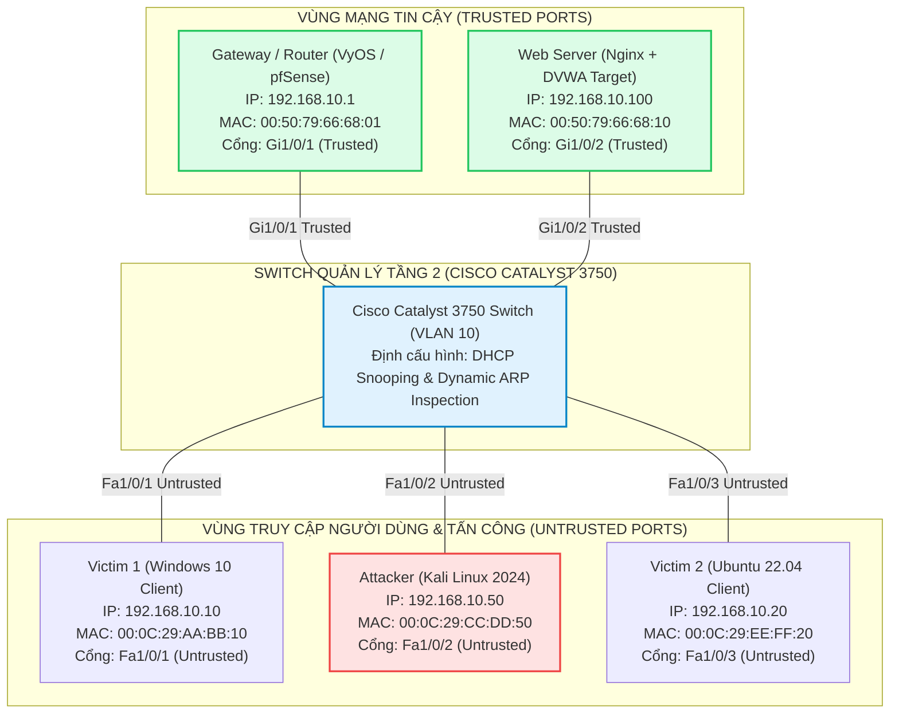
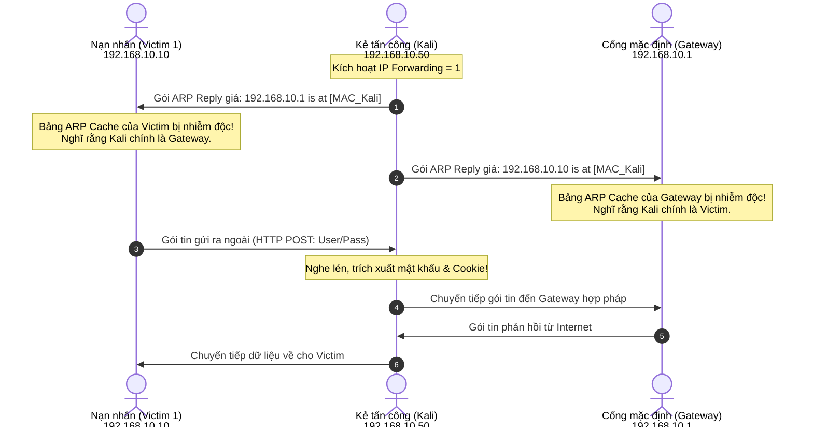
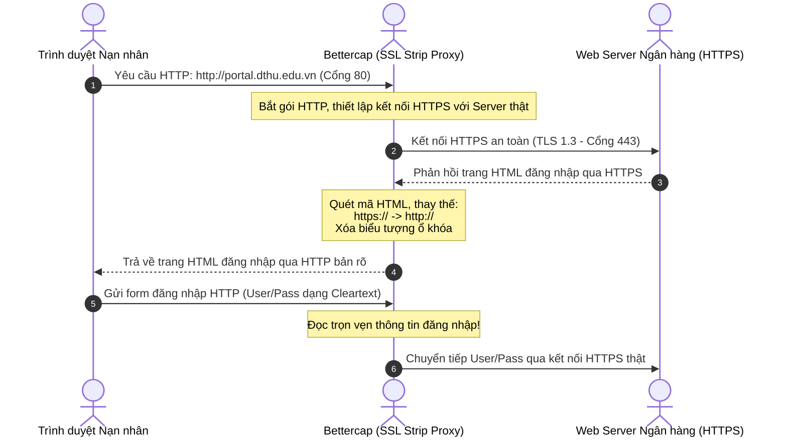
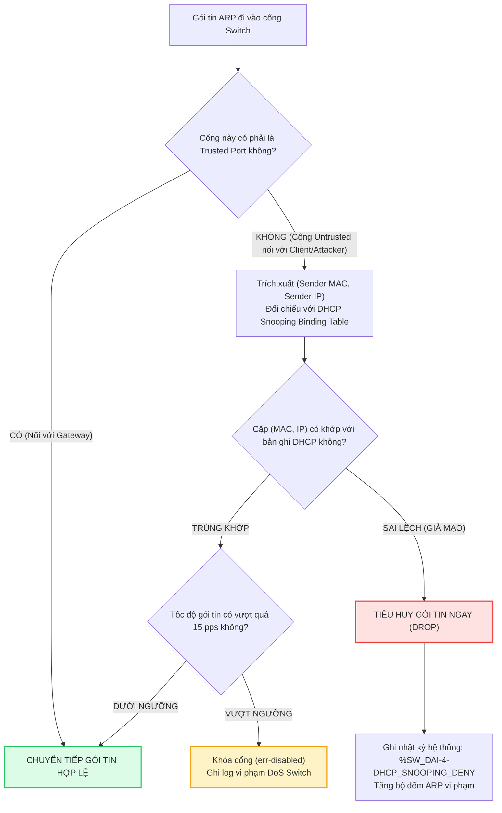

# Tổng Hợp Sơ Đồ Kiến Trúc Hệ Thống & Luồng Tấn Công (Mermaid Diagrams)

> **Mục đích:** Tập hợp toàn bộ các sơ đồ thiết kế kiến trúc kỹ thuật của hệ thống phòng thử nghiệm, luồng tấn công Man-in-the-Middle và các cơ chế phòng thủ chuyên sâu dưới dạng mã nguồn mở Mermaid trực quan, có thể dựng hình động ngay trên trình duyệt và xuất ra tài liệu báo cáo.

---

## 1. Sơ Đồ Topo Phòng Thử Nghiệm 5 Thành Phần (Testbed Lab Topology)

---

## 2. Sơ Đồ Cơ Chế Đầu Độc Hai Chiều (Bidirectional ARP Poisoning)

---

## 3. Sơ Đồ Tấn Công Bóc Tách SSL (SSL Stripping)

---

## 4. Sơ Đồ Cơ Chế Phòng Vệ Tầng 2: Dynamic ARP Inspection & DHCP Snooping

---

## 5. Sơ Đồ Cơ Chế Bảo Vệ Tầng Ứng Dụng: HSTS & Đường Hầm VPN

```mermaid
graph LR
    subgraph CLIENT_ZONE ["MÁY KHÁCH (VICTIM CLIENT)"]
        Browser["Trình duyệt Web<br/>Bộ nhớ HSTS Preload Cache"]
        VpnClient["WireGuard VPN Client<br/>Giao diện mạng ảo wg0"]
    end

    subgraph INTERMEDIATE_ZONE ["KÊNH TRUYỀN MẠNG LAN (CÓ KALI MITM)"]
        LanWire["Đường truyền vật lý LAN<br/>(Kẻ tấn công sniffing chỉ thấy UDP mã hóa)"]
    end

    subgraph SERVER_ZONE ["HẠ TẦNG MÁY CHỦ BẢO VỆ"]
        VpnServer["WireGuard VPN Server"]
        WebServer["Web Server Nginx<br/>Bật TLS 1.3 & HSTS RFC 6797"]
    end

    Browser -->|Tự động nâng cấp HTTPS nội bộ| VpnClient
    VpnClient -->|Đóng gói mã hóa ChaCha20-Poly1305| LanWire
    LanWire -->|Đường hầm an toàn| VpnServer
    VpnServer -->|Lưu lượng an toàn| WebServer

    style Browser fill:#e0f2fe,stroke:#0284c7,stroke-width:1px;
    style VpnClient fill:#dcfce7,stroke:#22c55e,stroke-width:2px;
    style LanWire fill:#fee2e2,stroke:#ef4444,stroke-width:2px;
    style WebServer fill:#dcfce7,stroke:#22c55e,stroke-width:2px;
```

